# MyWorkingMap — AI 작업 지도

AI 코딩 도우미(Claude Code)가 **무엇을 했는지**, 내가 **어느 방향으로 가고 있는지**를 그림으로 보여 주는 앱입니다.
PC마다 백그라운드에서 작업 기록을 모으고, 브라우저 화면에서 실시간으로 보여 줍니다. Mac, Windows, WSL을 모두 지원합니다.

**한 줄로**: 글로 된 긴 작업 기록을 **움직이는 에이전트 · 도형 · 흐름도**로 바꿔, 지금 무슨 일이 일어나는지 한눈에 본다.

| | |
|---|---|
| 🎬 **작업 현장** | 로봇 에이전트가 자료실·작업대·시험대를 오가며 지금 하는 일을 말풍선으로 |
| 🧭 **방향** | 최근 요청을 화살표로 이어 "어디로 가고 있는지", 방향이 바뀐 곳까지 |
| 🤖 **AI 해설** | 내 Claude·ChatGPT **구독 계정**으로 단계 · 상태 · 목표를 도형으로 정리 |
| 🔷 **흐름도** | 요청마다 계획 → 읽기 → 수정 → 실행 → 결과를 플로차트로, 서브에이전트까지 |
| 🤝 **MyCollaboBot** | 봇 팀에 일을 던지면 팀장이 나눠 맡기고 검토해 최종 결과까지. 나는 승인·수정 요청만. 허락 카드, 예약 실행 |
| ⬆️ **업데이트** | 새 버전이 나오면 화면에 알림, 버튼 하나로 업데이트 |

### 3분 만에 시작
1. [Releases](https://github.com/JinyoungPark/MyWorkingMap/releases)에서 zip을 받아 원하는 곳에 풉니다. Python 3.9 이상만 있으면 됩니다.
2. Mac은 `install/mac-install.command`, Windows는 `install/windows-install.cmd`를 **더블클릭**합니다.
3. 브라우저에 **AI 작업 지도**가 열립니다. 바탕화면 바로가기로 언제든 다시 열 수 있습니다.

설치 전에 화면만 먼저 보고 싶으면 `python3 aiworkmap.py demo`를 실행하세요. 예시 데이터로 모든 기능을 둘러볼 수 있습니다.

> 아래 화면은 모두 **예시 데이터**(가상의 "팀 할 일 앱" 프로젝트)입니다.

---

## 🎬 작업 현장 — 에이전트가 일하는 모습

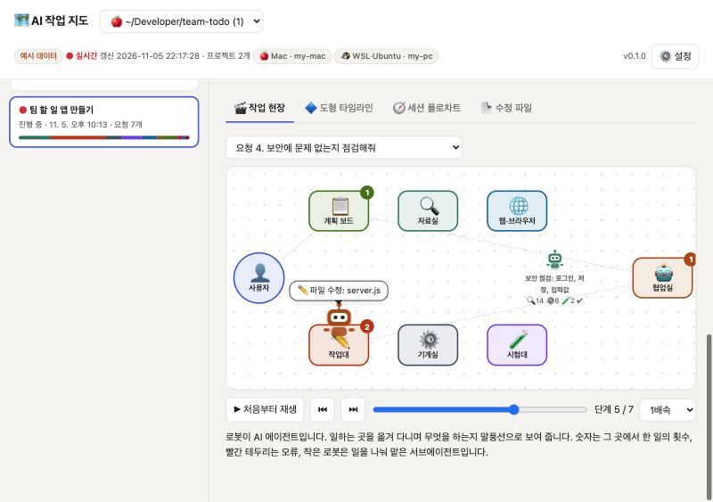

- **로봇 = AI 에이전트**입니다. 일하는 곳을 옮겨 다니며 지금 하는 일을 말풍선으로 보여 줍니다.

| 곳 | 하는 일 |
|---|---|
| 👤 사용자 | 요청을 받고, 끝나면 ✅ 보고 |
| 📋 계획 보드 | 할 일 계획 세우기 |
| 🔍 자료실 | 파일·코드 읽기, 찾기 |
| ✏️ 작업대 | 파일 수정 |
| ⚙️ 기계실 | 명령 실행 |
| 🧪 시험대 | 테스트 |
| 🌐 웹·브라우저 | 웹 검색, 화면 확인 |
| 📦 출하장 | 커밋, 배포 |
| 🤖 협업실 | 서브에이전트에게 일 맡기기 |

- **작은 로봇은 서브에이전트**입니다. 맡은 일과 한 일의 횟수(🔍14 ⚙️6 🧪2)가 함께 나옵니다.
- 작업대 위 숫자는 그곳에서 일한 횟수이고, **빨간 테두리**는 오류가 난 곳입니다.
- 지금 작업 중인 세션은 **● 실시간**으로 따라가고, 지난 요청은 **▶ 재생**(1·3·10배속)으로 다시 볼 수 있습니다.

## 🧭 지금 가고 있는 방향

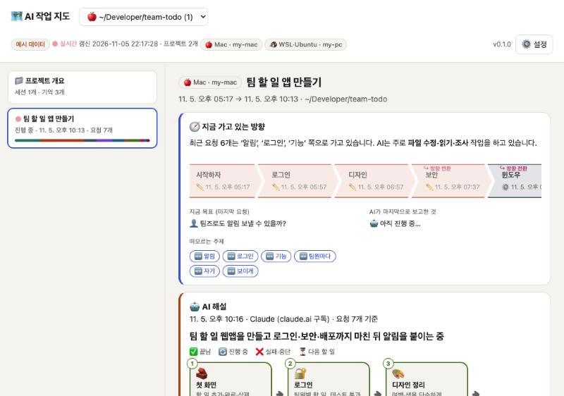

- 최근 요청 8개를 **화살표 길**로 잇고, 맨 끝에 🎯를 붙입니다. 화살표 색은 그 요청에서 AI가 주로 한 일입니다.
- 앞선 요청들과 주제가 완전히 달라지면 **↪ 방향 전환**으로 표시합니다.
- **지금 목표**(마지막 요청), **AI의 마지막 보고**, **떠오르는 주제**(🆕 새 주제, ▲ 늘어난 주제)를 함께 보여 줍니다.

## 🤖 AI 해설 — 글 대신 도형으로

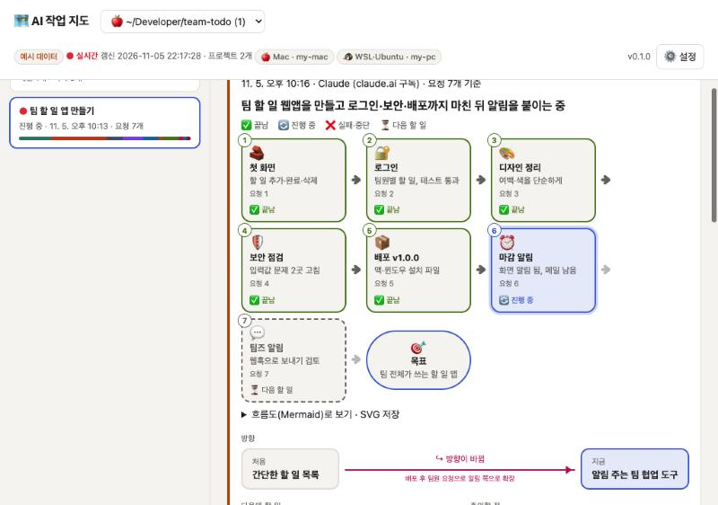

- **🤖 AI 해설 만들기**를 누르면, AI가 기록을 읽고 작업을 **단계 카드**로 정리합니다.

| 상태 | 표시 |
|---|---|
| ✅ 끝남 | 초록 테두리 |
| 🔄 진행 중 | 파란 강조 |
| ❌ 실패·중단 | 빨간 테두리 |
| ⏳ 다음 할 일 | 점선 |

- 단계 카드 아래에는 🎯 **목표**와, **처음 → 지금** 방향 화살표(방향이 바뀌었으면 ↪ 표시와 이유)가 붙습니다.
- 맨 아래에 **다음에 할 일**(번호 도형)과 **⚠ 주의할 점**이 나옵니다.
- AI에게는 글이 아니라 데이터(JSON)로 받고, 그림은 앱이 직접 그립니다. 그래서 매번 같은 모양으로 나옵니다.
- **내 구독 계정**을 씁니다. API 키는 필요 없습니다 (아래 [AI 연결](#-ai-연결--내-구독-계정) 참고).

## 🔷 요청 하나의 흐름도

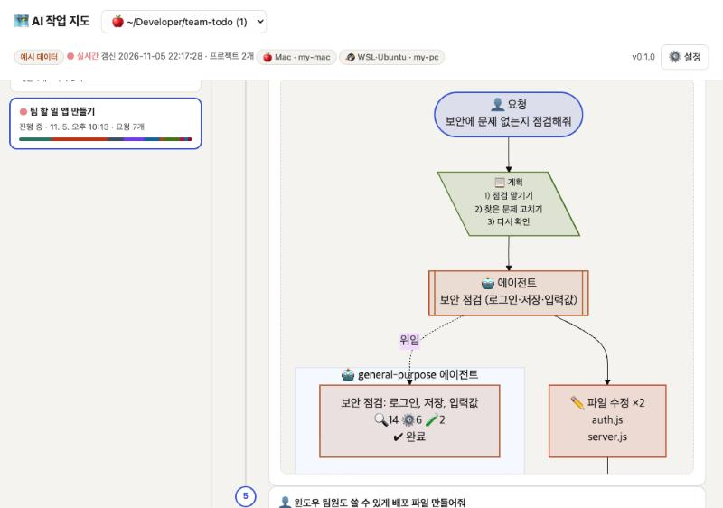

- **도형 타임라인**에서 요청 카드를 누르면, 그 요청의 흐름도가 펼쳐집니다.
- 흐름: 👤 요청 → 📋 계획 → 🤖 서브에이전트에게 맡김(따로 묶은 상자) → ✏️ 파일 수정 …
- 도형마다 의미가 있습니다.

| 도형 | 뜻 |
|---|---|
| 타원 | 요청, 결과 |
| 평행사변형 | 읽기 |
| 사각형 | 수정 |
| 이중 테두리 | 실행, 에이전트 |
| 육각형 | 웹 |
| 마름모 | 질문 |
| 원통 | 배포 |

- **SVG로 저장**, **Mermaid 코드 복사**로 문서나 발표 자료에 바로 넣을 수 있습니다.

## 🧭 세션 전체 흐름

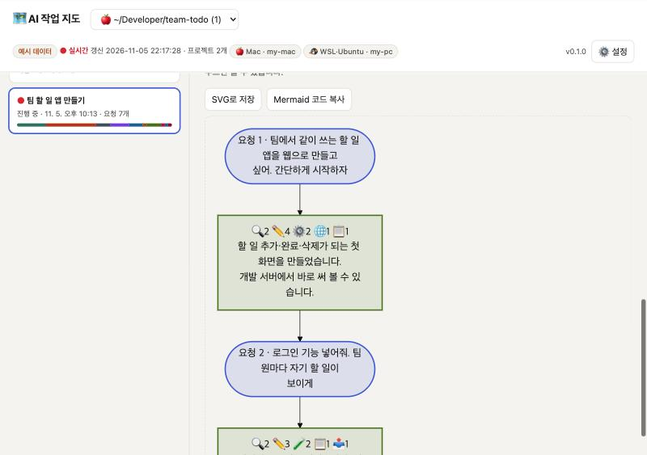

- 요청(파란 타원) → AI가 한 일의 횟수(🔍2 ✏️4 ⚙️2 …)와 결과(초록 상자)가 차례로 이어집니다.
- 최근 60개 요청까지 보여 줍니다.

## 🧠 AI가 기억하고 있는 내용

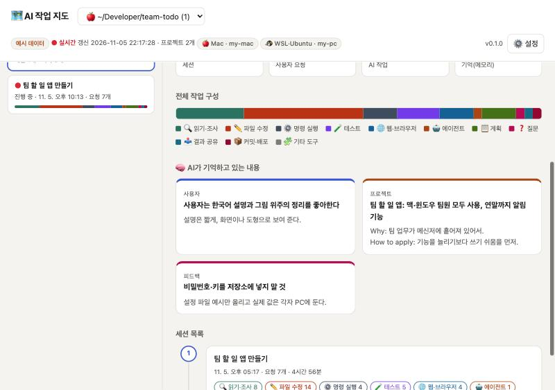

- 프로젝트 개요에서 Claude Code의 메모리(사용자 · 프로젝트 · 피드백 · 참고)를 카드로 보여 줍니다.
- 전체 작업 구성 막대로 어떤 일을 많이 했는지 한눈에 볼 수 있습니다.

## ⬆️ 새 버전 알림 · ⚙️ 설정

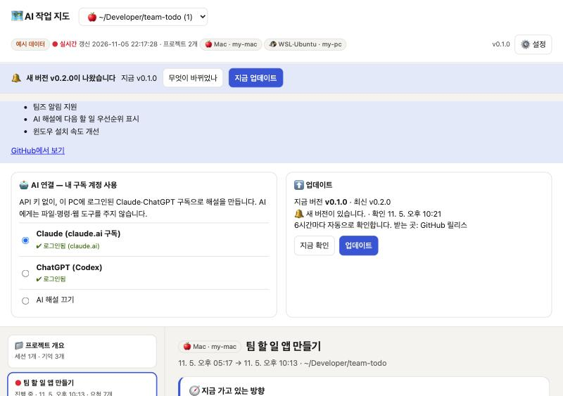

- 6시간마다 GitHub 릴리스를 확인합니다. 새 버전이 있으면 **🔔 알림 띠**와 시스템 알림을 띄웁니다.
- 알림 띠에서 **무엇이 바뀌었나**를 보고, **지금 업데이트**를 누르면 새 버전을 받아 바꿔 끼운 뒤 스스로 다시 시작합니다.
- ⚙️ 설정에서 **AI 연결**(Claude / ChatGPT / 끄기)과 **업데이트 확인**을 할 수 있습니다.

## 🤝 MyCollaboBot — 봇 팀을 직접 돌리기

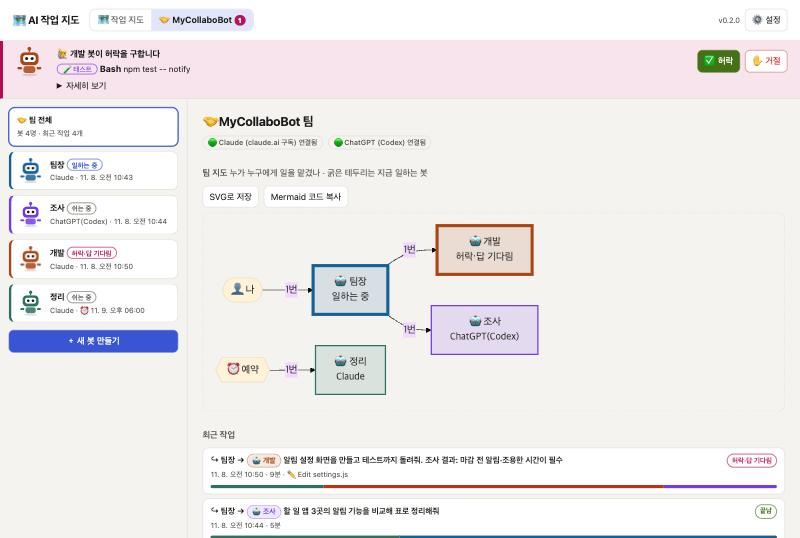

다른 프로그램 없이 이 앱에서 봇을 만들고 일을 맡깁니다. 봇은 이 PC에 로그인된 **내 구독 계정**(Claude Code `claude`, ChatGPT `codex`)으로 일하고, API 키는 쓰지 않습니다. 맨 위 **🤝 MyCollaboBot** 단추로 들어갑니다.

- **봇 만들기:** 이름, 역할, AI(Claude 또는 ChatGPT), 허락 방식, 작업 폴더를 정합니다. 작업 폴더를 비우면 봇 전용 폴더(`~/.ai-work-map/bots/<이름>/work`)를 씁니다.
- **일 맡기기:** 봇 화면에 할 일을 적고 **▶ 맡기기**를 누릅니다. Claude 봇은 이전 대화를 이어서 기억합니다(끌 수 있음).
- **팀 지도:** 누가 누구에게 일을 맡겼는지 화살표와 횟수로 보여 주고, 지금 일하는 봇은 굵은 테두리로 표시합니다.

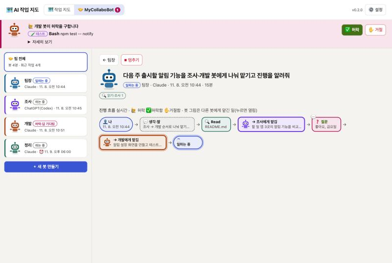

- **진행 흐름:** 봇이 한 일을 실시간으로 도형 칸으로 이어 보여 줍니다. 칸 색은 작업 지도와 같은 분류(🔍 읽기, ✏️ 수정, 🧪 테스트 …)를 따릅니다. 💬 말, 🙋 허락, ❓ 질문, 그리고 다른 봇에게 맡긴 일(봇 그림 칸, 누르면 그 작업이 열림)이 함께 나옵니다.
- **봇끼리 협업:** 봇은 `send_to_bot` 도구로 다른 봇에게 일을 넘기고, 그 봇이 끝낼 때까지 기다려 결과를 받습니다. Claude 봇과 ChatGPT 봇도 서로 주고받습니다. 넘기기는 3단계까지만 되고, 이미 거쳐 온 봇에게 되돌아가는 넘기기는 막습니다.

### 👥 팀 — 팀장이 알아서 진행, 나는 판단만

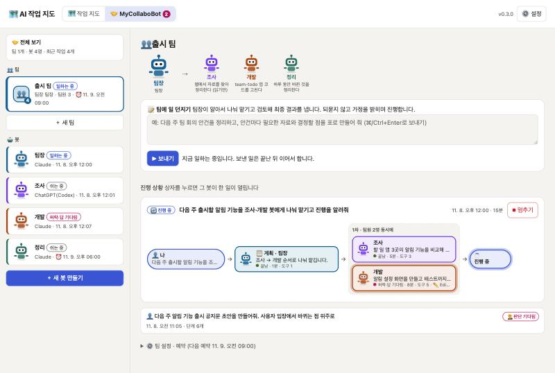

봇들을 팀으로 묶고(팀장 한 명 + 팀원 여럿) 팀에 일을 던지면, **팀장 봇이 알아서** 진행합니다. 진행 방식은 [MyCollaboratorBots](https://github.com/JinyoungPark/MyCollaboratorBots)와 같습니다.

1. **📋 계획:** 간단한 일이면 팀장이 바로 답하고, 아니면 팀원에게 나눠 맡깁니다. 한 번에 최대 4개를 맡기고, 맡은 팀원들은 동시에 일합니다.
2. **🔍 검토:** 팀장이 결과를 검토합니다. 빠졌거나 틀렸거나 서로 맞지 않는 부분이 있으면 다시 맡기고, 이를 최대 3차까지 되풀이합니다. 봇들은 사용자에게 되묻지 않고, 가정한 것을 밝힌 채 끝까지 진행합니다.
3. **🧩 임시 팀원:** 맞는 팀원이 없으면 팀장이 이번 일에만 쓰는 팀원(이름과 역할)을 만들어 맡깁니다. 임시 팀원은 팀장과 같은 AI로, 읽기만 합니다. 그래서 팀원을 정해 두지 않아도 됩니다.
4. **진행 상황:** 단계마다 상자로 보여 줍니다. 상자에는 맡은 봇, 맡은 일, 걸린 시간, 부른 도구 수, 지금 하는 일이 나옵니다. 같은 차수에 동시에 일한 팀원은 점선 묶음으로 보이고, 상자를 누르면 그 봇이 한 일이 열립니다.

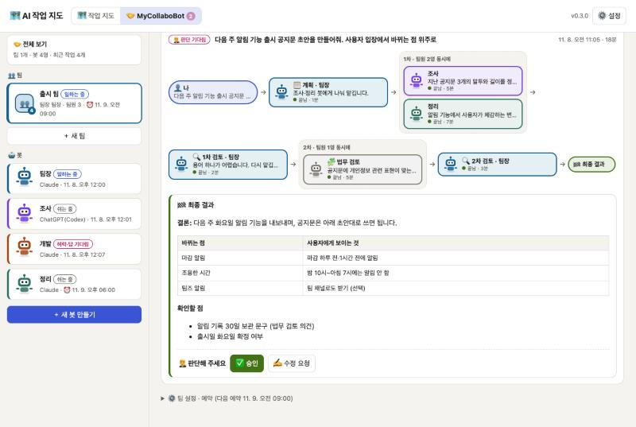

- **🏁 최종 결과 → 🧑‍⚖️ 판단:** 최종 결과는 결론, 근거, 확인할 점 순서로 나옵니다. 내가 **✅ 승인**하거나 **✍️ 수정 요청**(의견을 적으면 팀장이 이어서 고침)을 합니다. 결과가 나오면 시스템 알림이 뜨고, 맨 위 단추에 판단할 결과 수가 표시됩니다.
- 팀이 일하는 중에 보낸 일은 끝난 뒤 이어서 합니다. 팀마다 예약(매일, 평일, N분마다)을 둘 수 있습니다.
- 처음이면 왼쪽의 **✨ 예시 팀 만들기**를 누르세요. 팀장, 조사, 정리, 검토 봇과 '예시 팀'이 바로 만들어집니다.
- **📚 내 문서 검색:** [MyDocSearch](https://github.com/koreanregister-ict/DocSearch)(0.3.15 이상)가 설치되어 있으면 봇마다 그 찾기·읽기 도구를 붙입니다. MyDocSearch가 남긴 `mcp-launch.json`을 쓰며, 봇은 내 PC 문서를 근거와 함께 답합니다. MyDocSearch가 꺼져 있어도 됩니다.

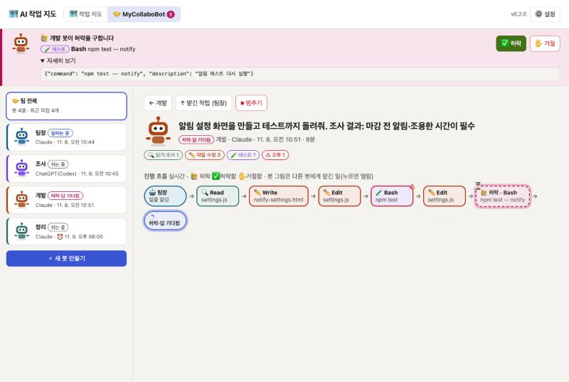

- **허락 요청:** 봇이 파일을 고치거나 명령을 실행하기 전에, 어느 화면에 있든 맨 위에 **🙋 허락 카드**가 뜹니다(✅ 허락 / ✋ 거절, 자세히 보기). 봇이 사람에게 물을 일이 있으면 **❓ 질문 카드**에 답을 적습니다. 30분 동안 답이 없으면 거절로 처리합니다.

  | 허락 방식 | Claude 봇 | ChatGPT(Codex) 봇 |
  |---|---|---|
  | 모두 물어보기 | 고치기·명령 전에 매번 묻기 | 작업 폴더 안에서만 고침 (묻지 않음) |
  | 파일 수정은 자동, 명령은 물어보기 | 수정은 바로, 명령만 묻기 | 작업 폴더 안에서만 고침 |
  | 읽기만 | 고치기·명령 금지 | 아무것도 고치지 못함 |

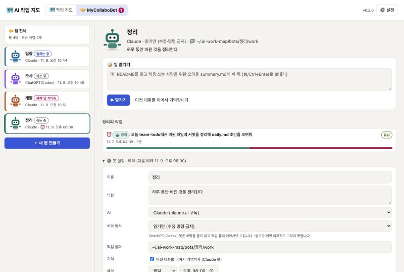

- **예약 실행:** 매일 또는 평일 정해진 시각, 또는 N분마다 정해 둔 일을 합니다. 앱(상주 프로그램)이 켜져 있어야 돌고, 정해진 시각에서 1시간 넘게 지났으면 그날은 건너뜁니다.
- 봇 정의와 작업 기록은 `~/.ai-work-map/bots`에 있습니다. Claude 봇이 한 세션은 작업 지도의 **🤝 MyCollaboBot 봇 팀** 프로젝트에도 봇 이름과 색으로 보입니다.

## 🤖 MausBot 봇 팀 보기

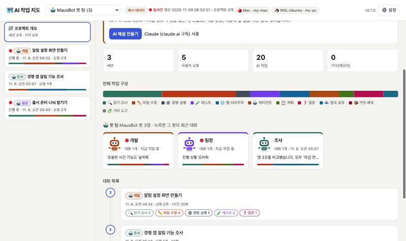

[OpenMausBot](https://github.com/milind-soni/OpenMausBot)(MausBot)으로 여러 AI 봇에게 일을 나눠 맡겼다면, 봇마다 무엇을 했는지 한 화면에서 봅니다. MausBot을 따로 설치하거나 연결할 필요는 없습니다.

- **어떻게 알아보나:** MausBot은 봇마다 이 PC의 `claude` CLI를 띄우므로, 봇이 한 일도 Claude Code 기록에 남습니다. 봇 작업 폴더(`Documents/MausBot/<봇>/<대화>`)나 MausBot이 붙여 주는 도구(`mcp__ogb__…`)로 봇의 기록을 알아봅니다.
- **🤝 MyCollaboBot 봇 팀** 프로젝트(MyCollaboBot 봇과 함께 모임): 봇마다 카드 한 장(봇 색깔, 대화 수, 지금 작업 중인지, 마지막 한 일, 작업 구성 막대). 누르면 그 봇의 최근 대화로 갑니다.
- 봇 전용 폴더에서 일한 기록은 봇 팀에만, 내 프로젝트 폴더에서 일한 기록은 그 프로젝트와 봇 팀 양쪽에 보입니다. 이 경우 봇 이름 대신 폴더 이름이 붙습니다.
- 🎬 작업 현장의 로봇이 봇 색깔과 이름표를 달고 움직입니다. 봇이 사용자에게 묻거나 허락을 구한 것은 ❓ 질문, 다른 봇에게 맡기거나 보고한 것은 🤖 에이전트로 표시합니다.
- **클라우드 봇·지난 기록:** `openmausbot export <대상> --out ~/.ai-work-map/mausbot/<이름>` 으로 내보낸 폴더를 자동으로 읽습니다. 다른 위치는 `config.json`에 적습니다.
  ```json
  { "mausbot_exports": ["~/Downloads/mausbot-export"] }
  ```
- ⚠️ MausBot은 기록 파일의 칸 이름을 문서로 밝히지 않아서, 내보내기 읽기는 흔한 이름을 두루 받아들이는 **시험 기능**입니다. Codex·Grok으로 도는 봇은 아직 보이지 않습니다(Claude Code 기록만 읽기 때문).
- 💡 MausBot 봇이 내 문서를 찾게 하려면: MyDocSearch → 설정 → AI·보안 → **AI 봇 (MausBot 등) · 설정 복사**를 누른 뒤, MausBot의 Plugins → MCP servers에 붙여 넣습니다. 이 설정은 보는 도구만 줍니다. MausBot은 Claude 봇을 띄울 때 이 PC의 Claude Code MCP 설정을 읽지 않으므로(`--strict-mcp-config`) MausBot에 따로 등록해야 합니다.

---

## 🖥️ 여러 PC · WSL

| PC | 설치 | 기록을 읽는 곳 |
|---|---|---|
| 🍎 Mac | `install/mac-install.command` (launchd, 로그인 시 자동 시작) | `~/.claude/projects` |
| 🪟 Windows | `install/windows-install.cmd` (시작프로그램, 관리자 권한 불필요) | `C:\Users\…\.claude\projects` |
| 🐧 WSL | 따로 설치하지 않음. Windows 쪽이 **켜져 있는 WSL**의 기록을 함께 읽음 | `\\wsl.localhost\…\.claude\projects` |

- 기본값은 PC마다 자기 기록만 봅니다.
- 여러 PC의 기록을 한 화면에 모으려면, 모든 PC의 `~/.ai-work-map/config.json`에 같은 공유 폴더를 적습니다.
  ```json
  { "store": "~/OneDrive - 회사이름/AI작업지도" }
  ```
- 기록마다 🍎 🪟 🐧 표시가 붙습니다.

## 🤖 AI 연결 — 내 구독 계정
MyDocSearch와 같은 방식입니다. 이 PC에 **구독 계정으로 로그인된 공식 프로그램**을 불러 씁니다.

| AI | 쓰는 프로그램 | 계정 |
|---|---|---|
| Claude | Claude Code (`claude -p`). Claude 데스크톱 앱에 든 것도 찾아 씀 | claude.ai Pro / Max |
| ChatGPT | Codex (`codex exec`). ChatGPT 데스크톱 앱에 든 것도 찾아 씀 | ChatGPT Plus / Pro |

- 로그인이 안 되어 있으면 ⚙️ 설정의 **로그인** 버튼을 누르세요. 브라우저가 열립니다.
- AI에게는 파일, 명령, 웹 도구를 **하나도 주지 않고**, 빈 폴더에서 실행합니다. 해설 만들기 자체는 작업 기록에 남지 않습니다.
- 버튼을 누를 때만 실행되며, 그때 구독 사용량을 씁니다.

## 🔒 지키는 것
- 화면은 이 PC(`127.0.0.1`)에서만 열립니다. 버튼 요청에는 화면마다 바뀌는 확인 토큰이 필요해서, 다른 웹사이트가 몰래 누를 수 없습니다.
- 요약에는 요청 문장, 단계 이름, AI 보고, 파일 이름만 들어갑니다. 파일 내용과 명령 출력은 넣지 않습니다.
- API 키, 토큰, 비밀번호처럼 보이는 문자열은 `[가림]`으로 바꿔 저장합니다.
- MyCollaboBot 봇은 내 계정 권한으로 이 PC에서 일합니다. 기본값은 '모두 물어보기'이고, 봇 도구가 앱에 보내는 요청은 앱을 켤 때마다 새로 만드는 열쇠로 확인합니다. 앱과 연결이 끊기면 허락 요청은 거절로 처리합니다.

## 명령 (필요할 때만)
```
python3 aiworkmap.py demo       # 예시 데이터로 둘러보기
python3 aiworkmap.py status     # 버전, 기록 위치, 저장소
python3 aiworkmap.py snapshot   # 지금 화면을 HTML 한 장으로 저장 (공유용)
python3 aiworkmap.py run        # 수집기 + 뷰어 직접 실행
python3 tools/release.py 0.2.0 "바뀐 점"   # (관리자) 새 버전 내보내기
```
- 로그: `~/.ai-work-map/agent.log`
- 바뀐 점: [CHANGELOG.md](CHANGELOG.md)

## 구성
| 파일 | 역할 |
|---|---|
| `aiworkmap.py` | 상주 프로그램 (수집기 + 브라우저 뷰어 + 명령) |
| `logparse.py` | 작업 기록 읽기, Mac·Windows·WSL 기록 위치 찾기, 비밀값 가리기 |
| `ai.py` | 구독 계정 AI 연결 (Claude Code · Codex) |
| `updater.py` | 새 버전 확인, 업데이트 |
| `collabo.py` | MyCollaboBot 봇 엔진 (봇 실행, 허락·질문 대기, 봇끼리 넘기기, 예약) |
| `mcb_mcp.py` | 봇에게 붙여 주는 도구 (approve · ask_user · list_bots · send_to_bot) |
| `template.html` | 화면 (작업 현장, 방향, 흐름도, AI 해설) |
| `demo.py` | 예시 데이터 |
| `install/` | Mac · Windows 자동 시작 설치 |
